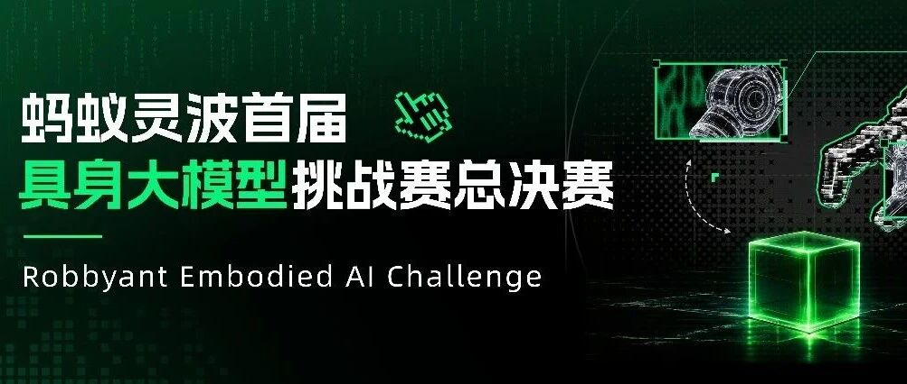

# VLA SFT in Practice - 🏆 总决赛二等奖 · Grand Final — Second Prize

[](https://yzmyalier.github.io/Lingbot-Challenge-SST/)


**Robbyant 具身智能挑战赛技术报告配套代码**

[English](README.md) | 简体中文

本仓库提供基于 LingBot-VLA 2.0 的 RoboTwin 实验所需的数据处理、训练和评测代码。最终方案结合 Qwen–SAM3 前景输入、mask 复核、原始图像教师监督、前景加权蒸馏、分模块学习率和数据完整性修复。

[环境安装](#环境安装) · [使用预处理数据快速开始](#使用预处理数据快速开始) · [数据集](#数据集) · [全量数据重建](#从-lerobot-v21-和-v30-全量重建) · [评测](#评测)

## 项目资源

| 资源 | 状态 |
|---|---|
| 项目主页与技术报告 | [Blog](https://yzmyalier.github.io/Lingbot-Challenge-SST/) |
| 修复后的 LeRobot 数据与预计算 SAM mask | 全量校验和上传完成后补充下载链接 |
| 训练后的 checkpoint | 单独发布后补充链接 |

完整的 Qwen–SAM3 预处理非常耗时。因此，我们将配套发布修复后的 LeRobot 数据、预计算 SAM mask 和渲染后的训练视频，方便直接开始训练，避免重复生成 mask。使用这些预处理数据训练时，无须运行 Qwen 或 SAM3 服务。

## 方法概览

1. **提取对象短语。** Qwen 根据指令和相机首帧识别相关对象。
2. **分割与跟踪。** SAM3 根据每个对象短语跟踪整条轨迹。
3. **复核对象 mask。** Qwen 同时读取原始帧和突出显示候选 mask 的图像，判断是否保留对象。
4. **构造策略输入。** 顶部相机图像保留被接受的前景、降低背景亮度并添加白色外缘；两路腕部图像保持不变。
5. **微调策略。** 策略读取带 mask 的图像，深度与视频教师读取对齐的原始图像。最终方案还使用前景加权蒸馏、分模块学习率和动作 padding mask。

最终配方关闭腕部颜色增强，虽然配置文件名中保留了 `wristaug`。

### 报告中的实验结果

| 配置 | 训练步数 | Clean 成功率 | Randomized 成功率 |
|---|---:|---:|---:|
| 绝对关节动作 baseline | 15,000 | 77.10% | 36.20% |
| 最终方案：N5 | 30,000 | 81.86% | 58.22% |

上述结果来自配套挑战赛技术报告。两组实验均只使用 clean 演示训练，并在两个评测场景中分别对 50 个任务、每任务 100 条轨迹进行评测。

## 环境安装

请前往以下官方项目，按照其说明安装所需的 Conda 环境：

| 环境 | 官方安装说明 | 在本仓库中的用途 |
|---|---|---|
| LingBot-VLA 2.0 | [官方仓库与安装说明](https://github.com/Robbyant/lingbot-vla-v2#installation) | 策略训练、数据加载和策略推理 |
| RoboTwin | [官方仓库](https://github.com/RoboTwin-Platform/RoboTwin)与[安装文档](https://robotwin-platform.github.io/doc/usage/robotwin-install.html) | 仿真与评测；按文档准备相应资产 |
| SAM3 | [官方安装说明](https://github.com/facebookresearch/sam3#installation) | 离线 mask 生成和在线 mask 推理 |
| vLLM | [官方仓库](https://github.com/vllm-project/vllm)与[完整源码编译说明](https://docs.vllm.ai/en/v0.20.2/getting_started/installation/gpu/#full-build-with-compilation) | 部署用于提词和 mask 复核的 Qwen 服务 |

vLLM 需要建立独立的 Conda 环境，并**从仓库源码编译安装**。本仓库的接入版本固定为 `v0.20.2`，commit 为 `bc150f50299199599673614f80d12a196f377655`；按照官方说明编译时请使用该版本。

通过上游说明安装依赖环境后，运行本仓库提供的入口，以使用这里维护的训练、数据处理和推理改动。

部分训练、推理和数据处理接口可能需要根据实际使用的 GPU 情况调整。运行入口前，请检查设备选择、并行方式、推理并发和显存相关设置。

### 配置路径

项目路径和解释器统一通过 [base.json](base.json) 与 [submit_paths.py](submit_paths.py) 解析。执行命令前，请将解释器路径替换为自己的 Conda 环境。数据处理所需依赖齐全时，`data` 可以与 LingBot-VLA 共用环境。

例如，将下面的占位路径替换为实际路径：

```bash
python3 tools/configure.py \
  --vla-python /path/to/lingbotvla/bin/python \
  --data-python /path/to/lingbotvla/bin/python \
  --robotwin-python /path/to/robotwin/bin/python \
  --sam3-python /path/to/sam3/bin/python \
  --vllm-python /path/to/vllm/bin/python
```

将 `paths.vllm_source` 指向编译 vLLM 使用的源码目录，将 `paths.ffmpeg` 指向 FFmpeg 可执行文件，并按照 RoboTwin 安装说明配置仿真运行库路径。数据、模型和输出位置均在 `base.json` 中配置。

以下命令默认在仓库根目录执行。

## 使用预处理数据快速开始

### 1. 准备配套数据集

数据发布链接可用后，下载修复后的 raw 数据和 SAM 数据，并放入[数据集](#数据集)一节约定的位置。默认 raw teacher 训练配方需要同时使用这两份数据。

仓库已附轨迹映射和原始指令文件，可以执行：

```bash
bash prepare_data_inputs.sh --check
```

两份数据放置完成后，将 SAM 元数据中的原始图像引用更新为配置中的本地位置：

```bash
python3 tools/configure.py --relocate
```

### 2. 下载训练所需的预训练模型

```bash
python3 download_public_weights.py \
  --only qwen3_vl --only lingbot_vla2 --only moge2
```

该命令根据固定版本的[模型清单](public_weights.json)下载公开的 backbone、初始策略和 teacher 资产，不包含我们微调后的 checkpoint 或预处理数据集。已有文件会通过清单中的哈希校验后复用。

### 3. 检查数据并启动训练

```bash
python3 tools/check_training_data.py
bash train.sh --check
bash train.sh
```

默认使用[最终 datafix 配方](Lingbot-vla-challenge/configs/vla/robotwin/robotwin_v30_formal_abs_sam_judge_0.1_multi_rawteacher_modlr_wristaug_datafix.yaml)，主要设置如下：

| 设置 | 取值 |
|---|---|
| 动作表示 | 绝对关节动作 |
| Action chunk 长度 | 50 |
| SAM 指令模式 | `multi` |
| 教师使用原始图像 | `aux_raw_image: true` |
| 前景加权蒸馏 | 启用 |
| 分模块学习率 | 启用 |
| 动作 padding mask | `mask_action_pad: true` |
| 腕部颜色增强 | `wrist_augment: false` |

可用 `bash train.sh --dry-run` 查看解析后的配方；数据准备完成前，也可用 `bash train.sh --check-models` 单独检查模型资产。

训练将实验配置和 checkpoint 写入 `paths.training_run`。评测这些 checkpoint 时，应保留同一实验下保存的 `lingbotvla_cli.yaml`。

## 数据集

数据发布包含两份配套数据集：

| 数据集 | 内容 | 配置字段 |
|---|---|---|
| 修复后的 LeRobot v3.0 raw | 完整相机视频、数值 state/action 数据及修复后的元数据 | `paths.raw` |
| Judged SAM multi | 渲染后的顶部视图、无损二值 mask、指令到 mask 的索引、judge 记录和配套训练元数据 | `paths.sam_output` |

默认目录结构：

```text
RoboTwinData/
└── lerobot_dataset/
    ├── RoboTwin_lerobot_v30_framefixed/
    └── RoboTwin_lerobot_v30_framefixed_sam_judged_multi_outline0.1_w2/
```

两份数据均保留完整的 **2,500 条轨迹**和 **548,893 个时刻**。Multi 指令数据为每条轨迹保留 **100 条有序 seen 指令**，共 **250,000 个指令槽位**。使用相同短语集合的槽位可以共享存储的 mask/视频组，但仍保留为独立的指令槽位。

修复过程使用 LeRobot v2.1 的视频恢复完整图像序列，同时保留 v3.0 的 episode ID 和数值 state/action。原始指令顺序保持不变，动作 padding mask 由训练代码应用。

Raw 数据同时为教师提供未加 mask 的原始图像，其位置记录在 SAM 数据的 `meta/sam_info.json` 中。移动两份配套数据后，使用 `tools/configure.py --relocate` 更新这一引用。

### Mask 语义

| 参数 | 取值 |
|---|---|
| 提词 prompt 版本 | `robotwin-sam3-v3.5` |
| SAM3 检测阈值 | `score_threshold_detection=0.3`、`new_det_thresh=0.5` |
| 对象接受条件 | 归一化 `P(yes) >= 0.5` |
| Judge 辅助图背景系数 | 0.2 |
| 最终渲染背景系数 | 0.1 |
| 最终外缘 | 白色，2 像素 |
| 保存的二值 mask | 无损 FFV1，值为 0/255；不包含外缘 |

Judge 辅助图的背景系数与最终渲染系数用途不同。对象判决只使用当前帧及此前的信息。

## 从 LeRobot v2.1 和 v3.0 全量重建

这条流程从公开 RoboTwin LeRobot v2.1 和 v3.0 输入重新生成完整数据集：修复 raw 数据、为全部轨迹和指令提取对象短语、运行 SAM3 跟踪与 Qwen mask 复核，最后组装完整 SAM 数据集。

**全量 mask 生成非常耗时，日常训练建议直接使用我们发布的预计算数据。**

### 1. 下载原始数据与分割模型

```bash
python3 download_public_weights.py \
  --only robotwin_data --only sam3 --only qwen3_8

bash prepare_data_inputs.sh --check
```

[下载清单](public_weights.json)固定了两份原始数据 ZIP 和模型文件的版本。仓库额外提供了映射与原始指令 JSON，因为两份 LeRobot ZIP 本身不包含完整的 multi 指令输入。

### 2. 修复原始视频

```bash
bash process_data.sh --check --stage raw
bash process_data.sh --stage raw
```

该阶段通过完整 state/action 序列匹配两种格式的数据，从 v2.1 恢复相机视频，并检查帧数、时间戳、尺寸及数值数据。

### 3. 启动 Qwen 并全量生成 SAM mask

在一个终端中启动已配置的 Qwen 服务：

```bash
python3 tools/services.py qwen
```

Mask 阶段运行期间保持服务开启。该接口提供 `Qwen/Qwen3.8-27B`，需要支持双图输入和 token log probabilities。

在另一个终端中执行全量 mask 流程：

```bash
bash process_data.sh --stage masks \
  --qwen-url http://127.0.0.1:8000/v1/chat/completions
```

Mask 阶段会自动启动 SAM3 worker，根据每条指令与轨迹首帧提取对象短语，在完整修复视频上跟踪对应对象，再由 Qwen 复核 mask，并为每个指令槽位渲染被接受的前景。

### 4. 组装并检查完整数据集

```bash
bash process_data.sh --stage assemble
python3 tools/check_training_data.py
```

组装要求全部轨迹完成，并执行输出校验。输出位置沿用训练所需的 `paths.raw` 和 `paths.sam_output`。Mask 生成完成且不再需要服务后，可以关闭手动启动的 Qwen 服务。

组合入口 `bash process_data.sh --stage all` 会执行上述各阶段，并自行管理 Qwen 服务。使用这个入口时，不要同时在配置中的接口地址手动管理另一份服务。

处理日志位于 `work/process_data/logs/`，mask 进度记录在 `work/process_data/sam-full-work/progress.json`。已完成的工作会缓存以支持续跑；输入、模型或处理代码发生变化时，需要使用新的工作目录。已有正式输出会被保留。

## 评测

评测前请准备 RoboTwin 环境与资产、SAM3 和 vLLM 环境、分割模型以及策略 checkpoint。SAM3 和 Qwen 资产可以通过同一个公开模型下载入口获取：

```bash
python3 download_public_weights.py --only sam3 --only qwen3_8

bash eval.sh --check
bash eval.sh
```

默认入口评测 `paths.training_run` 下第 30,000 步的 checkpoint，先运行 `demo_randomized`，再运行 `demo_clean`，每个任务评测 100 条轨迹。两种设置的结果分别保存在 `paths.eval_output` 下。

指定其他 checkpoint：

```bash
MODEL_PATH=/path/to/experiment/checkpoints/global_step_30000/hf_ckpt bash eval.sh
```

请随 checkpoint 保留该实验的 `lingbotvla_cli.yaml`。在线 mask 推理维护在 [inference/](inference/) 中，`RoboTwin/script/deploy/sam_mask/` 提供兼容导入。需要单独启动 mask 服务时，可执行 `bash start_inference_mask.sh`。

## 数据验证

检查完整配套数据，并通过实际训练加载器读取样本：

```bash
bash process_data.sh --stage validate
python3 tools/check_training_data.py
```

输出检查覆盖完整轨迹与指令、数值数据及文件哈希、mask 索引和 judge 错误，并抽样解码视频及 mask。组装过程还会解码每个唯一的渲染片段和最终 mask。训练加载器检查会读取轨迹首尾帧样本，包括 raw teacher 视图。

验证报告写入 `work/process_data/validation_report.json` 和 `work/sam_reuse_audit/training_loader_smoke.json`。这些检查用于确认数据完整性和加载兼容性；策略训练与 benchmark 评测需要分别执行。

## 仓库结构

| 路径 | 用途 |
|---|---|
| `train.sh`、`eval.sh` | 最终配方的训练与评测入口 |
| `process_data.sh`、`tools/` | 全量数据重建、配置、服务管理与验证 |
| `auto_mask/` | 离线提词、跟踪、判决与渲染 |
| `inference/` | 维护中的在线 mask 客户端和策略封装 |
| `data_inputs/` | 轨迹映射、原始指令、SAM 配置和来源记录 |
| `Lingbot-vla-challenge/` | 策略实现与实验配置 |
| `RoboTwin/` | 仿真与评测接入 |
| `sam3/` | 分割实现与项目适配 |
| `vllm_space/sam3_prompt.py` | 共用的对象提词 prompt |
| `tests/` | 数据完整性与下载器逻辑测试 |

## 致谢与第三方许可证

本项目基于 [LingBot-VLA 2.0](https://github.com/Robbyant/lingbot-vla-v2)、[RoboTwin](https://github.com/RoboTwin-Platform/RoboTwin)、[SAM3](https://github.com/facebookresearch/sam3)、Qwen 和 [vLLM](https://github.com/vllm-project/vllm) 构建。

第三方组件保留各自的许可证。请参阅仓库附带的 [LingBot-VLA 许可证](Lingbot-vla-challenge/LICENSE)、[RoboTwin 许可证](RoboTwin/LICENSE)、[SAM 许可证](sam3/LICENSE)及相应源码目录中的声明。
